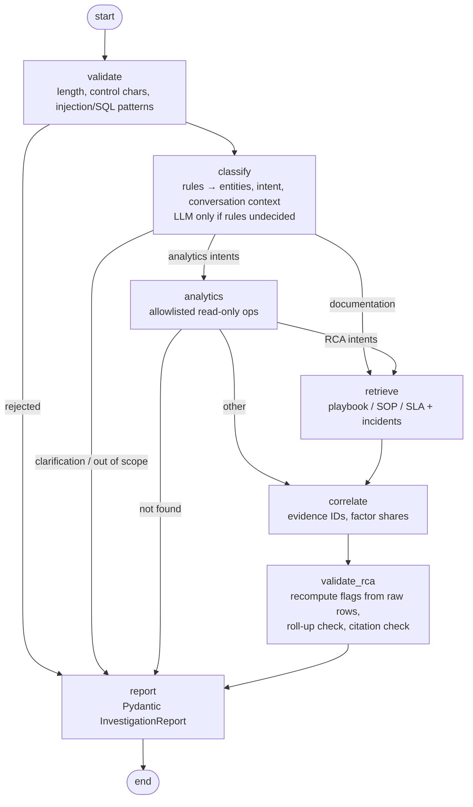

# Quick-Commerce AI Operations Intelligence Platform

Evidence-based **OR2A SLA analytics** and **root-cause investigation** for quick-commerce delivery operations.

Ask a question in plain English, such as *"Why did STORE_101 underperform?"*, and the platform pulls the numbers with SQL, applies deterministic RCA rules, searches the operations playbook with hybrid RAG, and returns a structured, cited incident report.

It runs **entirely locally**: PostgreSQL + pgvector, a LangGraph investigation workflow, local RAG, an MCP server and a React dashboard. **No paid API keys or cloud AI services.**

**🔗 Live demo:** https://qc-ops-intelligence-6bok.onrender.com

> The demo runs on Render's free tier: the first visit after 15 idle minutes takes about a minute to wake up. It runs the all-MiniLM embedding model in-process for hybrid search, but not the Qwen LLM, which needs more than the free 512 MB.

---

## Tech Stack

| Layer | Technologies |
|---|---|
| **Backend** | Python 3.11, FastAPI, LangGraph, LangChain |
| **Database** | PostgreSQL 16, pgvector, Alembic (migrations) |
| **AI / RAG** | Ollama (`qwen2.5:1.5b`, `all-minilm`), fastembed (ONNX), hybrid retrieval with RRF |
| **Frontend** | React, TypeScript, Vite |
| **Agent integration** | MCP server (6 read-only tools) |
| **DevOps** | Docker, Docker Compose, nginx, GitHub Actions, Render |
| **Testing** | pytest (**310 passing**) |

---

## Features

- **📊 Operations dashboard** (React + TypeScript): network and city KPIs, breach rate by hour, city and store comparisons, worst stores, and filters by city, store and date.
- **💬 AI investigation chat**: multi-turn questions that keep context, for example *"Why did STORE_101 underperform?"* → *"Walk me through the morning hours"* → *"What about STORE_102?"* → *"Compare them"*.
- **📝 Structured incident reports**: scope, observed metrics, rule-based contributing factors with evidence IDs, document citations, missing data, confidence limitations, next steps and corrective actions. Downloadable as Markdown, with an investigation history.
- **📚 RAG** over the RCA playbook, metric definitions and schema docs, plus clearly labelled **SAMPLE** SLA/SOP/incident documents (`knowledge_base/samples/`, not real company information).
- **🔌 MCP server** with six read-only tools for external agents.

**Trustworthy by design:** all numbers come from SQL and deterministic Python. Contributing factors are rule-based co-occurrences and are never presented as proven causes. The local LLM is optional and is not trusted with routing or calculations (see [docs/EVALUATION.md](docs/EVALUATION.md)).

> Upgraded from the original SQLite + Groq agent. The original RCA logic is preserved and verified line by line against its outputs.

---

## How It Works

### Investigation workflow (LangGraph)



### RCA rules

Every problem hour is checked against three independent rules, because causes can compound:

| Check | Rule | Flag |
|---|---|---|
| **Demand** | Actual orders > forecast × 1.10 | Demand spike |
| **Pileup** | Orders carried over from the previous hour (3+ consecutive hours = sustained) | Pileup / Sustained pileup |
| **Supply: booking** | Booked rider slots / available slots < 0.90 | Booking gap |
| **Supply: utilization** | Man-hour ratio < 0.85 (with no-show count) | Utilization gap |

### RAG pipeline

Knowledge-base markdown → heading-aware chunking (900 chars, 150 overlap) → 384-d all-MiniLM embeddings in pgvector (HNSW) + PostgreSQL full-text search (GIN) → **reciprocal rank fusion** → cited chunks.

See [docs/ARCHITECTURE.md](docs/ARCHITECTURE.md) for the full system, RAG and database diagrams.

---

## Quick Start (Local)

**Requirements:** Python 3.11, Node 18+, Ollama (optional). Tested on macOS (Intel), 8 GB RAM.

```bash
# 1. Python environment
python3.11 -m venv .venv && .venv/bin/pip install -r requirements-dev.txt

# 2. PostgreSQL 16 + pgvector (your own install, or the bundled pgserver binaries)
PGBIN=$(.venv/bin/python -c "import pgserver,os;print(os.path.dirname(pgserver.__file__))")/pginstall/bin
$PGBIN/initdb -D .pgdata -U postgres --auth=trust -E UTF8
$PGBIN/pg_ctl -D .pgdata -l .pgdata/server.log -o "-p 5432 -c listen_addresses=localhost" start
$PGBIN/psql -h localhost -U postgres -d postgres -f scripts/bootstrap_postgres.sql

# 3. Config, schema and data
cp .env.example .env                                   # set API_KEY_PEPPER
.venv/bin/python -m qc_rca.cli migrate
.venv/bin/python -m qc_rca.cli ingest                  # idempotent; re-runs are skipped
.venv/bin/python -m qc_rca.cli ingest-docs             # embeds with all-minilm if Ollama is running
.venv/bin/python -m qc_rca.cli create-key me analyst   # prints the API key once

# 4. (Optional) local models, ~1 GB total
ollama serve &
ollama pull qwen2.5:1.5b && ollama pull all-minilm

# 5. Run
.venv/bin/python main.py                               # API → http://127.0.0.1:8000 (docs: /docs)
cd frontend && npm install && cp .env.example .env && npm run dev   # UI → http://localhost:5173
```

Paste the API key into **Settings** in the UI, or use the CLI:

```bash
.venv/bin/python -m qc_rca.cli ask "Why did STORE_101 underperform?"
```

### Synthetic demo days (optional)

The real dataset covers a single day (2026-04-22). To demo the date filter and daily trend, generate clearly labelled synthetic days (seeded variations of the real day):

```bash
.venv/bin/python scripts/generate_synthetic_days.py
for f in data/synthetic/*.csv; do .venv/bin/python -m qc_rca.cli ingest --path "$f" --synthetic; done
```

Synthetic rows are stored with `is_synthetic = true`. The UI labels those dates "(synthetic)" with a warning banner, reports start with a **SYNTHETIC DEMO DATA** warning and get low confidence, and defaults and baselines use real dates only.

---

## Docker

```bash
export API_KEY_PEPPER=$(python3 -c "import secrets;print(secrets.token_urlsafe(32))")
docker compose up --build -d                      # db + api (:8000) + web (:8080)
docker compose exec api python -m qc_rca.cli create-key me analyst
```

| Service | Description |
|---|---|
| `db` | `pgvector/pgvector:pg16`, bootstrapped by `scripts/bootstrap_postgres.sql` |
| `api` | Migrates, ingests the CSV and knowledge base (idempotent), then serves. Defaults to `ENV=production` (auth required, `/docs` off). `LOAD_SYNTHETIC=true` also loads the demo days. |
| `web` | Production React build behind nginx. Set `PUBLIC_API_URL` to the URL browsers use to reach the API. |

Ollama is not containerised: the API uses `host.docker.internal:11434` if it is running, and works without it.

---

## MCP Server

```json
{
  "mcpServers": {
    "qc-ops": {
      "command": "/abs/path/.venv/bin/python",
      "args": ["-m", "qc_rca.mcp_server"],
      "cwd": "/abs/path/quick-commerce-rca-agent"
    }
  }
}
```

**Tools:** `store_analytics`, `rca_analysis`, `city_comparison`, `city_store_summary`, `sla_metrics`, `knowledge_search`. All are read-only, validated and time-limited.

---

## API

Full OpenAPI docs are available at `/docs`.

| Method & path | Role | Purpose |
|---|---|---|
| `GET /health` | public | DB + Ollama status |
| `GET /api/v1/analytics/meta` | viewer | Cities, stores, dates |
| `GET /api/v1/analytics/overview?date&city` | viewer | KPIs + breach by hour |
| `GET /api/v1/analytics/cities?date` | viewer | City comparison |
| `GET /api/v1/analytics/cities/{city}/stores?date` | viewer | Per-store roll-up |
| `GET /api/v1/analytics/breach-by-hour?date&city&store` | viewer | Hourly series |
| `GET /api/v1/analytics/top-stores?date&city&limit&min_orders` | viewer | Ranking |
| `GET /api/v1/analytics/stores/compare?stores=A,B&date` | viewer | Store comparison |
| `GET /api/v1/analytics/stores/{store}/hours?date&hour_from&hour_to` | viewer | Hourly detail |
| `GET /api/v1/analytics/stores/{store}/rca?date` | viewer | Deterministic RCA |
| `POST /api/v1/investigations` `{question, thread_id?}` | analyst (rate-limited) | Run the LangGraph workflow |
| `GET /api/v1/investigations`, `/{id}`, `/{id}/report.md` | analyst (own) / admin (all) | History and download |
| `POST /api/v1/knowledge/search` | analyst | Hybrid retrieval with filters |
| `POST /api/v1/admin/ingest`, `GET /api/v1/admin/audit` | admin | Ingestion, audit log |
| `POST /chat` | analyst | Legacy Streamlit compatibility |

**Security:** hashed API keys, role-based access (viewer / analyst / admin), rate limiting, audit logs and request IDs.

---

## Testing

```bash
.venv/bin/python -m pytest              # needs the local Postgres; Ollama tests skip if it is down
.venv/bin/python scripts/llm_probe.py   # re-measure the local model's capabilities
```

**Current result: 310 passed.**

### CI (GitHub Actions)

`.github/workflows/ci.yml` runs on every push to `main` and on pull requests:

1. **backend**: pytest against a real `pgvector/pgvector:pg16` service (Ollama-dependent tests skip).
2. **frontend**: `npm ci`, type-check, production build.
3. **docker**: builds both images, starts `db` + `api` with Compose, and checks `/health` and that unauthenticated requests get 401.

---

## Deployment

The public demo runs on Render's free web service from `render.yaml` and `deploy/Dockerfile.render`: a single container with Postgres + pgvector, the API and the React build.

- The database is created and loaded at image build time, so cold starts are quick and every restart returns to the same data (investigation history resets on restart).
- `PUBLIC_DEMO=true` lets visitors use the dashboards and investigations without a key (per-browser history, per-IP rate limits). Admin endpoints still need a key.
- Embeddings run in-process (`EMBEDDING_BACKEND=fastembed`, all-MiniLM-L6-v2 via ONNX, baked into the image), so hybrid retrieval works without Ollama. The container uses about 270 MB in CI.
- CI builds this image and smoke-tests it at 512 MB.

Free-tier limits (checked October 2026): sleeps after 15 minutes idle, takes about 1 minute to wake, and has no room for the Qwen LLM. The same image runs on any Docker host.

---

## Resource Usage (measured)

| Item | Size |
|---|---|
| Python venv (lean) | 187 MB |
| `pgserver` (PostgreSQL 16.2 + pgvector binaries) | ~10 MB wheel |
| Postgres data dir (`.pgdata`, both databases) | 113 MB |
| `frontend/node_modules` | 90 MB |
| Ollama models: qwen2.5:1.5b + all-minilm | 986 MB + 45 MB |

Idle RAM: Postgres ~50 MB with `shared_buffers=64MB`. Ollama loads models only on demand and unloads them after 5 minutes.

---

## Documentation

- [Architecture: system, workflow, RAG and database diagrams](docs/ARCHITECTURE.md)
- [Operations: security, failure handling, scaling, architecture decisions](docs/OPERATIONS.md)
- [Evaluation report (actual results)](docs/EVALUATION.md)
- [Knowledge base used by RAG](knowledge_base/)

---

## Author

**Shreyas Vikrant Dewangswami**
GitHub: [@dewangshree](https://github.com/dewangshree)
