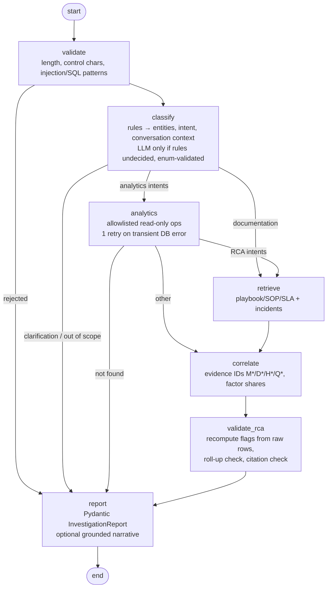
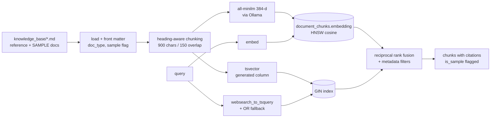

# Architecture

## System

```mermaid
flowchart LR
  UI[React + TS dashboard<br/>frontend/] -->|X-API-Key, REST| API
  ST[Streamlit (legacy)<br/>app.py] -->|POST /chat| API
  MCPC[MCP client<br/>e.g. Claude Desktop] -->|stdio| MCP[qc_rca.mcp_server]
  subgraph Backend [single Python process, modular]
    API[FastAPI<br/>auth · RBAC · rate limit · audit · request IDs] --> WF[LangGraph workflow]
    API --> AN[Analytics service<br/>allowlisted ops]
    WF --> AN
    WF --> RAG[RAG retriever<br/>hybrid RRF]
    MCP --> AN
    MCP --> RAG
    AN --> RCA[Deterministic RCA rules<br/>pure Python]
  end
  AN -->|read-only engine| PG[(PostgreSQL 16 + pgvector)]
  RAG -->|read-only engine| PG
  API -->|app engine| PG
  WF -.optional.-> OL[Ollama<br/>qwen2.5:1.5b · all-minilm]
  RAG -.query embedding.-> OL
```

All numbers come from SQL + `qc_rca/analytics/rca.py`. Ollama is optional: when it is down,
retrieval is keyword-only and intent falls back to rules / clarification. There is no paid-API code path.

## LangGraph investigation workflow



* Typed state: `InvestigationState` (TypedDict) + Pydantic report (`qc_rca/workflow/schemas.py`).
* Every node is wrapped: exceptions become report errors, per-node latency goes to `timings_ms`.
* Bounded retries: LLM calls `LLM_MAX_RETRIES` (default 1), narrative grounding 1 retry, DB 1 retry.
* Timeouts: LLM HTTP timeout, embedding timeout, Postgres `statement_timeout`, MCP tool timeout, `recursion_limit=20`.
* Checkpoints: `PostgresSaver` (tables `checkpoints*`), falling back to in-memory if unavailable.
* Multi-turn: `thread_id` → earlier questions in the thread supply store/city/date context.

## RAG pipeline



Ingestion is idempotent by per-document SHA-256 and re-embeds when `EMBEDDING_MODEL` changes.

## Database

```mermaid
erDiagram
  cities ||--o{ stores : has
  stores ||--o{ rider_slots : "has (per date)"
  stores ||--o{ store_hourly_metrics : "has (per date, hour)"
  rider_slots ||--o{ store_hourly_metrics : "capacity for"
  documents ||--o{ document_chunks : "split into"
  cities { int id PK; string name UK; string normalized_name UK }
  stores { int id PK; string code UK; int city_id FK }
  rider_slots { int id PK; int store_id FK; date charge_date; string slot_name; int current_size; int booked_size; float current_capacity_booked; float man_hour "nullable" }
  store_hourly_metrics { bigint id PK; int store_id FK; int slot_id FK; date charge_date; smallint hour; int total_orders; int breached_count; bool is_problem_hour; bool pileup_flag; float avg_or2a "nullable"; float order_projection }
  documents { int id PK; string source_path UK; string doc_type; bool is_sample; string sha256 }
  document_chunks { int id PK; int document_id FK; text content; vector embedding; tsvector tsv }
```

Application tables: `api_users` (hashed keys, role enum), `audit_logs`, `investigations` (JSONB report),
`ingestion_runs` (file SHA-256 for idempotency). Constraints: unique natural keys, `hour BETWEEN 0 AND 23`,
`breached_count <= total_orders`, non-negative counts. Indexes on `(charge_date, store_id)`,
`(charge_date, is_problem_hour)`, FKs, GIN on `tsv`, HNSW on `embedding`.

Rider capacity columns are constant within (store, date, slot) in the source (verified for all 2,280
slots), so they are normalised into `rider_slots`; ingestion fails if a file violates that.

## Code map

| Path | Responsibility |
|---|---|
| `qc_rca/config.py` | Settings (env / `.env`) |
| `qc_rca/db/` | ORM models, engines (read-write and read-only) |
| `qc_rca/ingestion.py` | Pydantic-validated, transactional, idempotent CSV upsert |
| `qc_rca/analytics/rca.py` | Deterministic RCA playbook rules |
| `qc_rca/analytics/service.py` | Allowlisted, parameterised analytics operations |
| `qc_rca/rag/` | Chunking, ingestion, hybrid retrieval |
| `qc_rca/llm/ollama.py` | Local model access, availability checks, usage metrics |
| `qc_rca/workflow/` | LangGraph graph, intent rules, evidence & validation |
| `qc_rca/security/auth.py` | API keys, RBAC, rate limiting |
| `qc_rca/api/` | FastAPI app and routers |
| `qc_rca/mcp_server.py` | Restricted MCP tools |
| `migrations/` | Alembic |
| `frontend/` | React + TypeScript dashboard |
